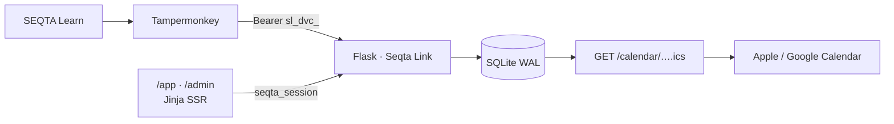

# Seqta Link

[English](README.md) | [中文](README.zh-CN.md)

**v3.1.1 — Flask + SQLite + Jinja portal · SEQTA timetable sync → ICS**

Self-hosted SEQTA Learn timetable sync for Apple / Google Calendar. Extract lessons in the browser (Tampermonkey), sync to your server, subscribe once to the ICS feed — no re-subscribe on each sync.

[](pyproject.toml)
[](LICENSE)
[](pyproject.toml)
[](pyproject.toml)

## Why Seqta Link

| Problem                                    | How this project handles it                   |
| ------------------------------------------ | --------------------------------------------- |
| Repeated sync creates duplicate events     | Stable server-side `UID` + natural keys       |
| Cancelled lessons stay on the calendar     | Deletes only within `complete: true` coverage |
| Partial week fetch wipes old data          | Incomplete coverage never triggers deletion   |
| Third-party servers hold SEQTA credentials | Backend never receives SEQTA passwords        |
| Guessable calendar URLs                    | Opaque feed tokens (`sl_cal_…`)               |

## Architecture



## Stack

| Layer         | Technology                                                                         |
| ------------- | ---------------------------------------------------------------------------------- |
| Backend       | Flask 3, SQLAlchemy 2, SQLite (WAL)                                                |
| Portal        | Jinja2 SSR — forms + `flash()`, fetch helpers use Toastify                         |
| UI motion     | CSS transitions / keyframes, AutoAnimate (lists), View Transition API (navigation) |
| Sync API      | `/api/v2/*` · device tokens `sl_dvc_…`                                             |
| Calendar feed | `/calendar/sl_cal_….ics` (ETag / `304`)                                            |
| Userscript    | Tampermonkey — `script/seqta-calendar-sync.user.js`                                |
| Tests         | `pytest`                                                                           |

> **v3 note:** The Node/Fastify/PostgreSQL stack and `/api/v1` are removed. See [docs/api-v2.md](docs/api-v2.md).

## Features

- **Browser extract** — Tampermonkey reads SEQTA timetable; pair device + sync
- **Idempotent sync** — `Idempotency-Key` + SQLite transactions; per-calendar lock
- **Stable ICS** — RFC 5545, stable HMAC `UID`, `SEQUENCE`, cancelled retention
- **Token security** — Device (`sl_dvc_…`) and calendar (`sl_cal_…`) tokens; pepper-hashed at rest
- **Local accounts** — Email/password login; invite-only registration; `/app` and `/admin` portals
- **Brute-force guard** — Login and pairing attempt lockout (in-process)
- **Ops** — Flask CLI: `init-db`, `bootstrap-owner`, `backup`

## Quick start

**Requirements:** Python 3.11+, pip

```bash
cp .env.example .env
# Generate secrets:
# python -c "import base64,os; print(base64.b64encode(os.urandom(32)).decode())"
# Set TOKEN_PEPPER, UID_SECRET, SESSION_SECRET in .env

pip install -e ".[dev]"

# Optional first-boot owner:
# OWNER_BOOTSTRAP_EMAIL=you@example.com
# OWNER_BOOTSTRAP_PASSWORD='…'

python run.py
# → http://127.0.0.1:3210
```

| URL                              | Purpose             |
| -------------------------------- | ------------------- |
| `/app/login`                     | User portal sign-in |
| `/admin/login`                   | Admin sign-in       |
| [docs/api-v2.md](docs/api-v2.md) | HTTP API reference  |

**Recommended sync path:**

1. Sign in → **Devices** → generate pairing code.
2. Install `script/seqta-calendar-sync.user.js` in Tampermonkey ([script/README.md](script/README.md)).
3. Open SEQTA → **Pair device** → enter code → **Sync Timetable**.
4. Portal → **Calendar** → rotate subscription URL → add to Apple/Google Calendar.

```bash
pytest                      # unit + integration tests
npm run build:userscript      # rebuild userscript from script/src/ (Node optional)
```

## CLI

```bash
flask --app run:app init-db
flask --app run:app bootstrap-owner
flask --app run:app backup
```

## Configuration

See [.env.example](.env.example). Production essentials:

- `PUBLIC_BASE_URL` — HTTPS public URL
- `COOKIE_SECURE=true` — required behind HTTPS
- `TOKEN_PEPPER`, `UID_SECRET`, `SESSION_SECRET` — distinct random base64 (≥32 bytes decoded)
- `DATABASE_PATH` — SQLite file path (default `./data/seqta.db`)
- `AUTH_DEV_LOGIN=false` in production

## Deploy

Single-process app with SQLite — run one instance (WAL + in-process locks). Use **gunicorn** or **waitress** behind HTTPS (Cloudflare Tunnel, reverse proxy, etc.).

See [docs/pve_deploy.md](docs/pve_deploy.md) for Proxmox LXC deployment.

## Project layout

```
seqta_link/           # Flask app (models, services, blueprints, templates, static)
run.py                # Dev server entry
tests/                # pytest
script/               # Tampermonkey userscript sources + build
docs/                 # api-v2.md, pve_deploy.md
deploy/               # systemd unit templates
```

## License

See [LICENSE](LICENSE).
