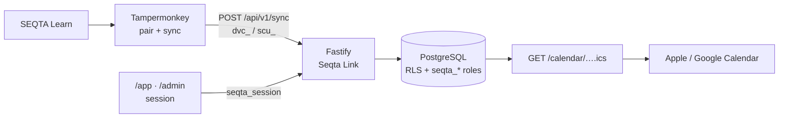

# Seqta Link

[English](README.md) | [中文](README.zh-CN.md)

**v2.1.0 — Self-hosted SEQTA timetable sync → Apple / Google Calendar (ICS)**

Extract lessons from SEQTA Learn with a Tampermonkey userscript, sync them to a small Fastify backend, and subscribe once in Apple or Google Calendar. Every manual sync updates the same feed — no re-subscribe, no SEQTA credentials on the server.

[](package.json)
[](LICENSE)
[](package.json)
[](package.json)
[](package.json)
[](test/)

|                            |                          |
| -------------------------- | ------------------------ |
| **81** automated tests     | **TypeScript** Fastify 5 |
| **PostgreSQL** + RLS roles | **RFC 5545** ICS feed    |
| **Tampermonkey** capture   | **Node 24+** runtime     |



npm package: `seqta-link@2.1.0`

---

## Why Seqta Link

| Problem                                 | How this project handles it                   |
| --------------------------------------- | --------------------------------------------- |
| Duplicate calendar events after re-sync | Server-side stable `UID` + natural keys       |
| Cancelled lessons sticking around       | Deletes only inside `complete: true` coverage |
| Partial week failures wiping data       | Incomplete coverage never triggers deletes    |
| Credentials on a third-party server     | Backend never sees SEQTA passwords or cookies |
| Guessable calendar URLs                 | Opaque feed tokens (`scc_…`)                  |

---

## Features

- **Userscript capture** — reads the SEQTA timetable in-browser; Pair device + Sync
- **Idempotent sync** — `Idempotency-Key` + PostgreSQL transactions under RLS
- **Stable ICS** — RFC 5545 for Apple / Google / Android; ETag / `304`; cancelled events retained
- **Token security** — upload (`scu_…`), device (`dvc_…`), and calendar (`scc_…`) tokens, peppered hashes
- **Local accounts** — email/password login; invite-only registration; portal `/app` and admin `/admin`
- **Abuse protection** — rate limits + failed-attempt lockout on login, invite accept, pair, and API token probing
- **Ops-ready** — `cli init` / `create-feed` / `rotate-token` / `inspect-feed` / `backup` / `bootstrap-owner` / `migrate-v1-sqlite`; PVE + Cloudflare Tunnel templates
- **Tested core** — unit, integration, and golden ICS fixtures

---

## Quick start

**Requirements:** Node.js 24+, npm, [Tampermonkey](https://www.tampermonkey.net/) (embedded PostgreSQL by default — no separate DB install)

```bash
cp .env.example .env
# Local macOS/dev: set EMBEDDED_PG_DATA_DIR=./data/pg (and EMBEDDED_PG=true)
npm ci
# Approve embedded-postgres platform postinstall when prompted
mkdir -p ./data/pg            # or /var/lib/seqta-calendar/pg
npm run build
npm run cli -- init           # interactive .env (secrets, PUBLIC_BASE_URL, owner bootstrap…)
npm run db:migrate
# Owner: created by init bootstrap env on first boot, or:
npm run cli -- bootstrap-owner --email you@example.com --password '…'

npm run dev                   # app + embedded Postgres
```

**Recommended sync path:**

1. Sign in at `/app` → **Devices** → generate a pairing code.
2. Install `script/seqta-calendar-sync.user.js` in Tampermonkey (see [script/README.md](script/README.md)).
3. On SEQTA → **Pair device** → enter code + device name → **Sync Timetable**.
4. Portal → **Calendar** → generate subscription URL → add in [Apple](web/help/apple.html) or [Google](web/help/google.html).
5. Optional: `/admin` for invitations, user management, audit.

**CLI-provisioned feed (legacy / ops):** still available when you need an upload token without the portal:

```bash
npm run cli -- create-feed \
  --name "My Timetable" \
  --school-host "learn.example-school.edu.au" \
  --student-ref "4284" \
  --timezone "Australia/Sydney"
```

Legacy upload tokens (`scu_…`) still work via userscript Settings. Device pairing (`dvc_…`) is preferred.

```bash
npm test                      # unit + integration; real RLS: EMBEDDED_PG=false + DATABASE_URL_TEST
npm run build:userscript      # rebuild script/seqta-calendar-sync.user.js from script/src/
```

---

## CLI

```bash
npm run cli -- <command> [options]
```

| Command | Purpose |
| ------- | ------- |
| `init` | Interactive `.env` (secrets, URLs, owner bootstrap) |
| `bootstrap-owner` | Create / promote owner when none exists |
| `create-feed` | Provision user + calendar + upload device (prints tokens once) |
| `rotate-token` | Rotate upload or calendar token (`--feed <id> --type upload\|calendar`) |
| `inspect-feed` | Inspect calendar status / event counts |
| `backup` | `pg_dump` + gzip |
| `migrate-v1-sqlite` | One-shot import from a v1 SQLite DB |

---

## Repository layout

| Path                   | Role                                          |
| ---------------------- | --------------------------------------------- |
| `src/`                 | Fastify 5 + PostgreSQL backend                |
| `src/modules/`         | auth, calendars, sync, devices, me, admin, …  |
| `database/migrations/` | schema, RLS, DB roles, local-auth grants      |
| `script/`              | Tampermonkey userscript (source + built file) |
| `web/`                 | Portal / admin / invite / help static pages   |
| `docs/`                | API + Proxmox deploy guide                    |
| `deploy/`              | systemd & Cloudflare Tunnel templates         |
| `test/`                | Unit, integration, and golden tests           |

Deploy unit / path names under `/opt/seqta-calendar` are historical and unchanged for existing hosts.

---

## Documentation

- [docs/api.md](docs/api.md) — HTTP API, tokens, auth, rate limits
- [docs/pve_deploy.md](docs/pve_deploy.md) — Proxmox VE / Debian LXC deploy guide
- [web/help/apple.html](web/help/apple.html) / [web/help/google.html](web/help/google.html) — Apple / Google·Android subscribe guides
- [script/README.md](script/README.md) — userscript install & `sourceKey` rules
- [.env.example](.env.example) — all environment variables (including lockout knobs)

---

## License

This project is licensed under the **GNU Affero General Public License v3.0**, with **additional non-commercial terms**.

- **Open source required:** modifications you distribute or offer as a network service must publish complete corresponding source under the same terms (AGPL-3.0 + these additional terms).
- **Non-commercial only:** commercial use (including paid hosting or selling derivatives) is not allowed without a separate written license.

See [LICENSE](LICENSE) for the full text.
