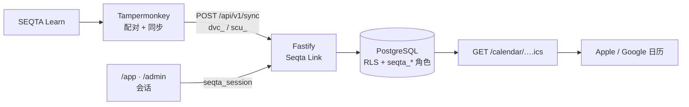

# Seqta Link

[English](README.md) | [中文](README.zh-CN.md)

**v2.1.0 — 自托管 SEQTA 课表同步 → Apple / Google 日历（ICS）**

用 Tampermonkey 脚本从 SEQTA Learn 提取课表，同步到轻量 Fastify 后端，在 Apple 或 Google 日历中订阅一次即可。之后每次手动同步都会更新同一 Feed——无需重新订阅，服务端也不接触 SEQTA 账号密码。

[](package.json)
[](LICENSE)
[](package.json)
[](package.json)
[](package.json)
[](test/)

|                           |                          |
| ------------------------- | ------------------------ |
| **81** 项自动化测试       | **TypeScript** Fastify 5 |
| **PostgreSQL** + RLS 角色 | **RFC 5545** ICS Feed    |
| **Tampermonkey** 抓取     | **Node 24+** 运行时      |



npm 包名：`seqta-link@2.1.0`

---

## 为什么需要 Seqta Link

| 痛点                     | 本项目的处理方式                     |
| ------------------------ | ------------------------------------ |
| 反复同步产生重复日历事件 | 服务端稳定 `UID` + natural key       |
| 已取消课程仍留在日历里   | 仅在 `complete: true` 覆盖范围内删除 |
| 某周抓取失败误删旧数据   | 不完整覆盖不会触发删除               |
| 第三方服务器保存账号凭据 | 后端从不接收 SEQTA 密码或 Cookie     |
| 日历 URL 可被猜测        | 不透明 Feed Token（`scc_…`）         |

---

## 功能特性

- **脚本抓取** — 在浏览器内读取 SEQTA 课表；支持 Pair device + Sync
- **幂等同步** — `Idempotency-Key` + PostgreSQL 事务（RLS）
- **稳定 ICS** — RFC 5545（Apple / Google / Android）；ETag / `304`；取消课程保留
- **Token 安全** — 上传（`scu_…`）、设备（`dvc_…`）、日历（`scc_…`）令牌分离，加 pepper 哈希存储
- **本地账号** — 邮箱密码登录；邀请制注册；用户门户 `/app` 与管理端 `/admin`
- **防爆破** — 登录、邀请注册、设备配对、API Token 探测均有限流与失败锁定
- **运维就绪** — `cli init` / `create-feed` / `rotate-token` / `inspect-feed` / `backup` / `bootstrap-owner` / `migrate-v1-sqlite`；提供 PVE 与 Cloudflare Tunnel 模板
- **测试覆盖** — 单元、集成与 ICS golden fixture

---

## 快速开始

**环境要求：** Node.js 24+、npm、[Tampermonkey](https://www.tampermonkey.net/)（默认内嵌 PostgreSQL，无需单独装库）

```bash
cp .env.example .env
# 本地开发：EMBEDDED_PG=true，EMBEDDED_PG_DATA_DIR=./data/pg
npm ci
# 首次需允许 embedded-postgres 平台包的 postinstall（见 npm 提示）
mkdir -p ./data/pg            # 或 /var/lib/seqta-calendar/pg
npm run build
npm run cli -- init           # 交互式配置 .env（密钥、公开链接、管理员引导等）
npm run db:migrate
# Owner：init 写入的引导变量可在首次启动创建，或：
npm run cli -- bootstrap-owner --email you@example.com --password '…'

npm run dev                   # 应用 + 内嵌 Postgres
```

**推荐同步路径：**

1. 登录 `/app` → **Devices** → 生成配对码。
2. 在 Tampermonkey 中安装 `script/seqta-calendar-sync.user.js`（详见 [script/README.md](script/README.md)）。
3. 打开 SEQTA → **Pair device** → 输入配对码与设备名 → **Sync Timetable**。
4. 门户 → **Calendar** → 生成订阅 URL → 按 [Apple](web/help/apple.html) / [Google](web/help/google.html) 说明添加。
5. 可选：`/admin` 发邀请、管用户、看审计。

**CLI 创建课表（运维 / 旧路径）：** 无需门户即可拿到上传 Token：

```bash
npm run cli -- create-feed \
  --name "My Timetable" \
  --school-host "learn.example-school.edu.au" \
  --student-ref "4284" \
  --timezone "Australia/Sydney"
```

旧版上传 Token（`scu_…`）仍可在脚本 Settings 中使用；推荐设备配对（`dvc_…`）。

```bash
npm test                      # 单元 + 集成；真实 RLS：EMBEDDED_PG=false + DATABASE_URL_TEST
npm run build:userscript      # 从 script/src/ 重新构建 userscript
```

---

## CLI

```bash
npm run cli -- <command> [options]
```

| 命令 | 用途 |
| ---- | ---- |
| `init` | 交互式生成 `.env`（密钥、URL、owner 引导） |
| `bootstrap-owner` | 库中尚无 owner 时创建 / 提升管理员 |
| `create-feed` | 创建用户 + 日历 + 上传设备（Token 只打印一次） |
| `rotate-token` | 轮换上传或日历 Token（`--feed <id> --type upload\|calendar`） |
| `inspect-feed` | 查看日历状态 / 事件统计 |
| `backup` | `pg_dump` + gzip |
| `migrate-v1-sqlite` | 从 v1 SQLite 一次性导入 |

---

## 仓库结构

| 路径                   | 说明                                     |
| ---------------------- | ---------------------------------------- |
| `src/`                 | Fastify 5 + PostgreSQL 后端              |
| `src/modules/`         | auth、calendars、sync、devices、me、admin 等 |
| `database/migrations/` | schema、RLS、DB 角色、本地认证相关授权   |
| `script/`              | Tampermonkey 同步脚本（源码 + 构建产物） |
| `web/`                 | 门户 / 管理端 / 邀请 / 帮助页静态资源    |
| `docs/`                | API + Proxmox 部署指南                   |
| `deploy/`              | systemd 与 Cloudflare Tunnel 模板        |
| `test/`                | 单元 / 集成 / golden 测试                |

部署路径 `/opt/seqta-calendar` 等为单位历史命名，已有主机可继续沿用。

---

## 文档

- [docs/api.md](docs/api.md) — HTTP API、Token、认证与限流
- [docs/pve_deploy.md](docs/pve_deploy.md) — Proxmox VE / Debian LXC 部署教程
- [web/help/apple.html](web/help/apple.html) / [web/help/google.html](web/help/google.html) — Apple / Google·Android 订阅说明
- [script/README.md](script/README.md) — 脚本安装与 `sourceKey` 规则
- [.env.example](.env.example) — 全部环境变量（含防爆破参数）

---

## 许可证

本项目采用 **GNU Affero General Public License v3.0**，并附加 **非商业使用条款**。

- **二次开发必须开源：** 你分发或通过网络提供的修改版本，必须按相同条款（AGPL-3.0 + 本附加条款）公开完整对应源码。
- **仅限非商业使用：** 未经版权方另行书面许可，不得将本软件用于商业用途（包括有偿托管或出售衍生作品）。

完整文本见 [LICENSE](LICENSE)。
