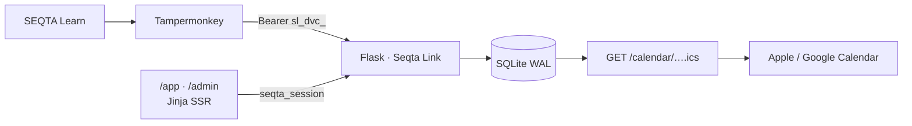

# Seqta Link

[English](README.md) | [中文](README.zh-CN.md)

**v3.1.2 — Flask + SQLite + Jinja 门户 · SEQTA 课表同步 → ICS**

自托管 SEQTA Learn 课表同步，订阅 Apple / Google 日历。浏览器（Tampermonkey）抓取课表，同步到服务端，ICS 订阅一次即可，后续同步自动更新同一 Feed。

[](pyproject.toml)
[](LICENSE)
[](pyproject.toml)
[](pyproject.toml)

## 为什么需要 Seqta Link

| 痛点                     | 本项目的处理方式                     |
| ------------------------ | ------------------------------------ |
| 反复同步产生重复日历事件 | 服务端稳定 `UID` + natural key       |
| 已取消课程仍留在日历里   | 仅在 `complete: true` 覆盖范围内删除 |
| 某周抓取失败误删旧数据   | 不完整覆盖不会触发删除               |
| 第三方服务器保存账号凭据 | 后端从不接收 SEQTA 密码              |
| 日历 URL 可被猜测        | 不透明 Feed Token（`sl_cal_…`）      |

## 架构



## 技术栈

| 层        | 技术                                                                              |
| --------- | --------------------------------------------------------------------------------- |
| 后端      | Flask 3、SQLAlchemy 2、SQLite（WAL）                                              |
| 门户      | Jinja2 SSR — 表单 + `flash()`，Fetch 操作用 Toastify                              |
| 动效      | CSS transitions / keyframes、AutoAnimate（列表）、View Transition API（页面跳转） |
| 同步 API  | `/api/v2/*` · 设备令牌 `sl_dvc_…`                                                 |
| 日历 Feed | `/calendar/sl_cal_….ics`（ETag / `304`）                                          |
| 脚本      | Tampermonkey — `script/seqta-calendar-sync.user.js`                               |
| 测试      | `pytest`                                                                          |

> **v3 说明：** Node/Fastify/PostgreSQL 与 `/api/v1` 已移除。API 见 [docs/api-v2.md](docs/api-v2.md)。

## 功能特性

- **脚本抓取** — 浏览器内读取 SEQTA 课表；配对设备 + 同步
- **幂等同步** — `Idempotency-Key` + SQLite 事务；每日历进程内锁
- **稳定 ICS** — RFC 5545、稳定 HMAC `UID`、`SEQUENCE`、取消课程保留
- **Token 安全** — 设备（`sl_dvc_…`）与日历（`sl_cal_…`）分离，pepper 哈希存储
- **本地账号** — 邮箱密码登录；邀请制注册；用户门户 `/app` 与管理端 `/admin`
- **防爆破** — 登录、配对失败锁定（进程内存）
- **运维** — Flask CLI：`init-db`、`bootstrap-owner`、`backup`

## 快速开始

**环境要求：** Python 3.11+、pip

```bash
cp .env.example .env
# 生成密钥：
# python -c "import base64,os; print(base64.b64encode(os.urandom(32)).decode())"
# 在 .env 中设置 TOKEN_PEPPER、UID_SECRET、SESSION_SECRET

pip install -e ".[dev]"

# 可选：首次启动创建 owner
# OWNER_BOOTSTRAP_EMAIL=you@example.com
# OWNER_BOOTSTRAP_PASSWORD='…'

python run.py
# → http://127.0.0.1:3210
```

| 地址                             | 说明          |
| -------------------------------- | ------------- |
| `/app/login`                     | 用户门户登录  |
| `/admin/login`                   | 管理端登录    |
| [docs/api-v2.md](docs/api-v2.md) | HTTP API 文档 |

**推荐同步路径：**

1. 登录 `/app` → **Devices** → 生成配对码。
2. Tampermonkey 安装 `script/seqta-calendar-sync.user.js`（详见 [script/README.md](script/README.md)）。
3. 打开 SEQTA → **Pair device** → 输入配对码 → **Sync Timetable**。
4. 门户 → **Calendar** → 轮换订阅 URL → 添加到 Apple/Google 日历。

```bash
pytest                      # 单元 + 集成测试
npm run build:userscript      # 从 script/src/ 重新构建 userscript（可选 Node）
```

## CLI

```bash
flask --app run:app init-db
flask --app run:app bootstrap-owner
flask --app run:app backup
```

## 配置

见 [.env.example](.env.example)。生产环境要点：

- `PUBLIC_BASE_URL` — 公网 HTTPS 地址
- `COOKIE_SECURE=true` — HTTPS 下必须开启
- `TOKEN_PEPPER`、`UID_SECRET`、`SESSION_SECRET` — 互不相同，base64 解码至少 32 字节
- `DATABASE_PATH` — SQLite 文件路径（默认 `./data/seqta.db`）
- 生产关闭 `AUTH_DEV_LOGIN`

## 部署

SQLite 单机部署 — 只运行一个实例（WAL + 进程内锁）。生产用 **gunicorn** 或 **waitress**，前置 HTTPS。

详见 [docs/pve_deploy.md](docs/pve_deploy.md)（Proxmox LXC）。

## 目录结构

```
seqta_link/           # Flask 应用（models、services、blueprints、templates、static）
run.py                # 开发服务器入口
tests/                # pytest
script/               # Tampermonkey 脚本源码与构建
docs/                 # api-v2.md、pve_deploy.md
deploy/               # systemd 模板
```

## 许可

见 [LICENSE](LICENSE)。
